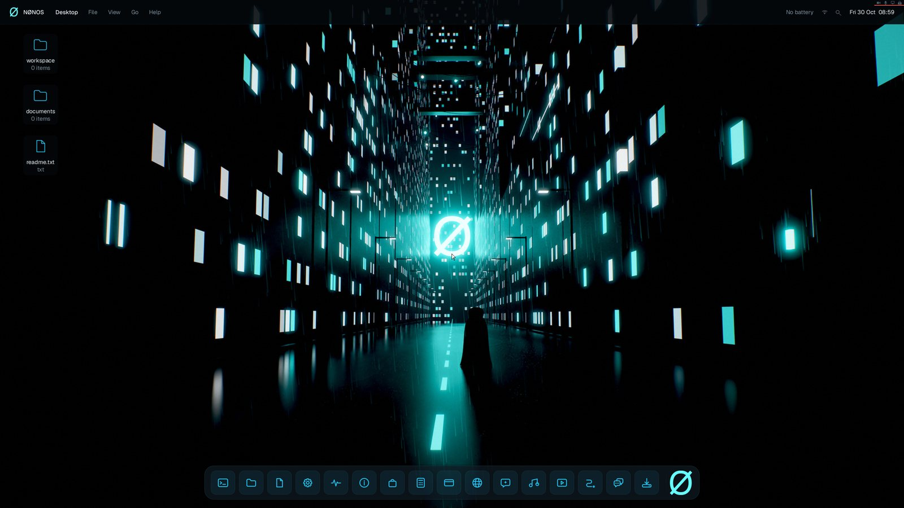
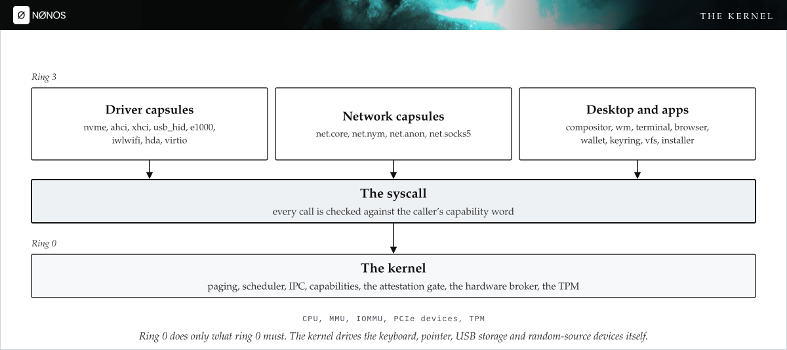
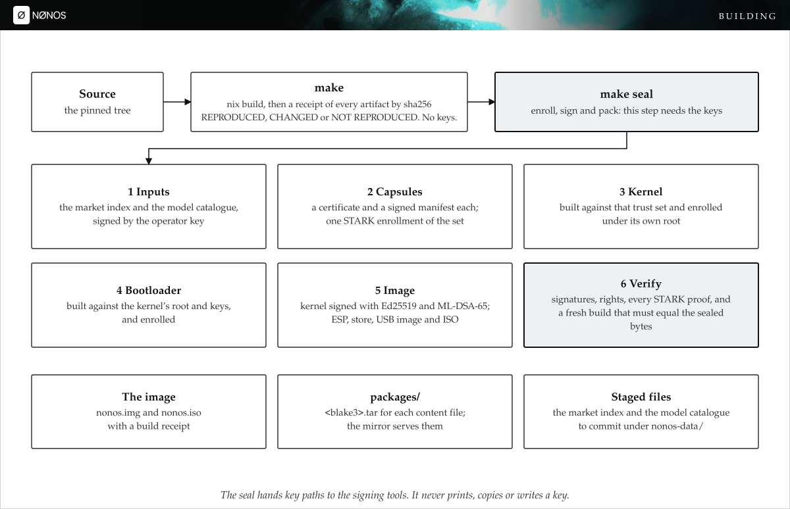
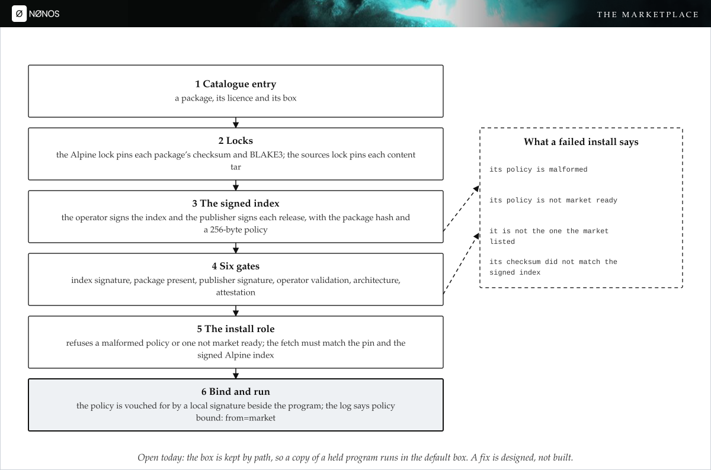
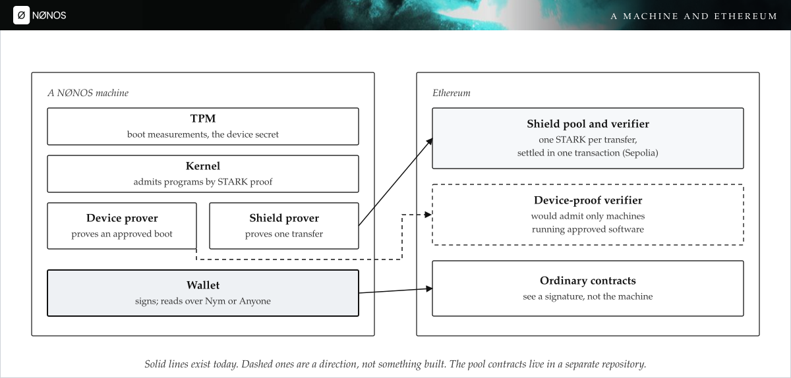

 

NØNOS is an operating system built from bare metal around one idea: a machine should trust as little as
possible and remember as little as it needs. The kernel starts from zero state, runs from memory, and
loads only software whose signature it can check. Every privilege is a capability granted on purpose,
never something a process inherits by accident.

The rest of the stack follows the same rule. The NØNOS STARK is a transparent proof system written from
scratch, with no trusted setup and no pairings. NØNOS Shield uses it to move value privately on
Ethereum: one transaction per transfer, and inside it the chain verifies the whole proof itself.

## The system

Every program runs in a box: a short list, in its signed listing, of what it may touch. A window. Its own
home folder. The network over Nym or Anyone. Anything not on the list is refused, and the log says why.
The Marketplace lists 31 Linux programs, each with its own box. In 0.9.3 a program whose box grants a window opens it on the NØNOS desktop, as KeePassXC, swayimg and foot do, and gets no rights of its own.

Ring 0 does only what ring 0 must. Drivers, networking and the desktop are capsules in ring 3, and every
call they make is checked against a 40-bit capability word. Memory is wiped when you power off, and
nothing touches a disk unless you install.

## From source to a machine you can check

A program reaches a NØNOS machine only through a build that anyone can repeat and a signature the kernel
verifies before it runs a single instruction. Capsules carry a hybrid signature, Ed25519 and ML-DSA-65,
checked against a sealed trust anchor.

The Marketplace applies the same chain to third-party software, so a listing says what a program may do
and the kernel holds it to that.

Where a claim can be checked by a machine, it is: by a signature, by a transparent proof, or by a test
that fails when the property breaks.

## NØNOS Shield

Private transfers on Ethereum L1, verified by a STARK in a single transaction.

<table>
  <tr>
    <td align="center" width="25%"><b>1 transaction</b> per private transfer, with the whole proof verified on chain</td>
    <td align="center" width="25%"><b>0 trusted setups</b> no ceremony, no pairings, no off-chain verifier</td>
    <td align="center" width="25%"><b>Every constraint</b> recomputed by the chain, not supplied by the prover</td>
    <td align="center" width="25%"><b>Sepolia</b> first end-to-end private transfers settled, in ETH and NOX</td>
  </tr>
</table>

Solid lines exist today. Dashed ones are a direction. Blinded proofs, proving on your own device and an
external audit come before mainnet.

## Repositories

<table>
  <tr>
    <th align="left" width="22%">Kernel</th>
    <td>
      <a href="https://github.com/NON-OS/microkernel"><b>microkernel</b></a> The NØNOS microkernel, in Rust 
      <a href="https://github.com/NON-OS/releases"><b>releases</b></a> Every release: images, checksums and the public material to verify them 
      <a href="https://github.com/NON-OS/microkernel/tree/main/docs"><b>docs</b></a> Kernel, userland and security documentation, in the microkernel repository 
      <a href="https://github.com/NON-OS/microkernel/tree/main/nonos-ci"><b>nonos-ci</b></a> Static checks, baselines and trust-chain CI
    </td>
  </tr>
  <tr>
    <th align="left">Trust chain</th>
    <td>
      <a href="https://github.com/NON-OS/microkernel/tree/main/nonos-sign"><b>nonos-sign</b></a> Capsule signer and verifier, Ed25519 and ML-DSA-65 
      <a href="https://github.com/NON-OS/microkernel/tree/main/nonos-mk"><b>nonos-mk</b></a> Capsule packager and marketplace index 
      <a href="https://github.com/NON-OS/nonos-mirror"><b>nonos-mirror</b></a> The package mirror 
      <a href="https://github.com/NON-OS/microkernel/tree/main/stark-attest"><b>stark-attest</b></a> Attest a set of artifacts with one 32-byte statement, transparently
    </td>
  </tr>
  <tr>
    <th align="left">Proofs and Shield</th>
    <td>
      <a href="https://github.com/NON-OS/STARKs"><b>STARKs</b></a> A transparent STARK over Goldilocks: circuits, verifiers, wallet prover, Zig client and Lean core 
      <a href="https://github.com/NON-OS/L1-Shield"><b>L1-Shield</b></a> Private payments on Ethereum L1, one STARK per transfer 
      <a href="https://github.com/NON-OS/shield-core"><b>shield-core</b></a> The Rust core of NØNOS Wallet 
      <a href="https://github.com/NON-OS/shield-android"><b>shield-android</b></a> · <a href="https://github.com/NON-OS/shield-ios"><b>shield-ios</b></a> NØNOS Wallet for Android and iOS 
      <a href="https://github.com/NON-OS/zkolang"><b>zkolang</b></a> A verifiable-compute language, proven by the NØNOS STARK
    </td>
  </tr>
  <tr>
    <th align="left">Security toolkit</th>
    <td>
      <a href="https://github.com/NON-OS/nmap-cli"><b>nmap-cli</b></a> · <a href="https://github.com/NON-OS/subfinder-cli"><b>subfinder-cli</b></a> · <a href="https://github.com/NON-OS/dnsx-cli"><b>dnsx-cli</b></a> · <a href="https://github.com/NON-OS/naabu-cli"><b>naabu-cli</b></a> · <a href="https://github.com/NON-OS/httpx-cli"><b>httpx-cli</b></a> · <a href="https://github.com/NON-OS/katana-cli"><b>katana-cli</b></a> · <a href="https://github.com/NON-OS/ffuf-cli"><b>ffuf-cli</b></a> · <a href="https://github.com/NON-OS/nuclei-cli"><b>nuclei-cli</b></a> Eight safety-first recon orchestrators: scope-first, dry-run by default, hash-chained audit, SSH-signed scope. Italian, English and 中文.
    </td>
  </tr>
  <tr>
    <th align="left">Nil and tools</th>
    <td>
      <a href="https://github.com/NON-OS/NIL"><b>NIL</b></a> A private workspace for teams who sign in with a wallet: tasks, docs, chat and files, encrypted in the browser 
      <a href="https://github.com/NON-OS/nonos.software"><b>nonos.software</b></a> Wiki, manual, ISO downloads and news 
      <a href="https://github.com/NON-OS/BuyBot"><b>BuyBot</b></a> · <a href="https://github.com/NON-OS/gitbot"><b>gitbot</b></a> · <a href="https://github.com/NON-OS/NOXDashboard"><b>NOXDashboard</b></a> · <a href="https://github.com/NON-OS/NOXtools"><b>NOXtools</b></a> · <a href="https://github.com/NON-OS/nonos-wallpapers"><b>nonos-wallpapers</b></a>
    </td>
  </tr>
</table>

## Reporting a vulnerability

Write to [team@nonos.systems](mailto:team@nonos.systems), or use the security policy of the repository
concerned. Please do not open a public issue for a weakness.

 

  <a href="https://nonos.software"><b>nonos.software</b></a>
  &nbsp;·&nbsp;
  <a href="https://nonos.systems"><b>nonos.systems</b></a>
  &nbsp;·&nbsp;
  <a href="mailto:team@nonos.systems"><b>team@nonos.systems</b></a>

<i>Trust nothing you cannot verify. Keep nothing you do not need.</i>

